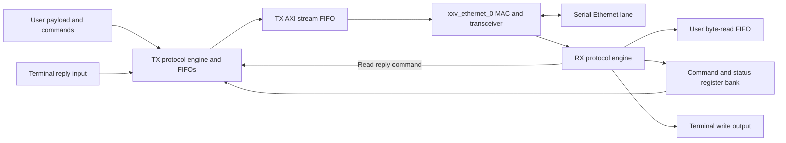

# AXI Ethernet 10G Top

A Vivado FPGA project for a single-lane, 64-bit 10 Gigabit Ethernet datapath. The design connects an AMD/Xilinx Ethernet IP core to user payload FIFOs, command queues, a command/status register bank, and terminal data interfaces.

The top-level entity is **`eth_manager`**, implemented in [`HDL/eth_manager.vhd`](HDL/eth_manager.vhd). Several modules retain historical `tri_mode` and `RGMII` names; the active top connects them to the 64-bit `xxv_ethernet_0` interface.

**Project status:** this repository contains an integration snapshot with known missing dependencies and board-specific work remaining. The publication cleanup changes comments, formatting, and the top-level file reference; it does not validate or change the HDL logic. No tests, simulation, synthesis, or implementation were run as part of this cleanup.

## Project settings

| Setting | Value recorded in the project |
| --- | --- |
| Tool version | Vivado 2025.2 |
| FPGA part | `xcvu9p-flga2104-2-i` |
| Project file | `Prj/axi_ethernet_10g_top.xpr` |
| Top entity | `eth_manager` |
| Main language | VHDL, with a retained Verilog clock/reset helper |
| MAC stream width | 64 data bits and 8 byte-valid bits |
| Transceiver reference clock | Differential 156.25 MHz input |
| MAC management clock | `clk_100MHz` input |
| Register bank | 128 registers, 64 bits each |

The target board is not specified by the project. The FPGA part and the supplied constraints should not be treated as a complete board definition.

## Repository layout

```text
.
|-- Constraints/   Legacy IBERT example constraints
|-- HDL/           Application RTL and retained reference modules
|-- IP/            Vivado IP configurations (.xci) and core containers (.xcix)
|-- Prj/           Vivado project file
`-- README.md      Architecture, interfaces, and integration notes
```

Vivado caches, generated output directories, logs, and implementation products are excluded by `.gitignore`. IP configurations and core containers remain versioned. `.gitattributes` keeps text line endings consistent and treats `.xcix` containers as binary files.

## Architecture



| Active source | Purpose |
| --- | --- |
| [`eth_manager.vhd`](HDL/eth_manager.vhd) | Connects the MAC, outgoing stream FIFO, and application bridge; exports MAC-generated clocks. |
| [`gtx.vhd`](HDL/gtx.vhd) | Wraps `xxv_ethernet_0` with fixed MAC control settings. |
| [`ethernet_mac_RGMII_basic_pat_gen.vhd`](HDL/ethernet_mac_RGMII_basic_pat_gen.vhd) | Connects the TX engine, RX engine, and register bank. |
| [`tri_mode_ethernet_mac_v5_5_0_axi_pat_gen.vhd`](HDL/tri_mode_ethernet_mac_v5_5_0_axi_pat_gen.vhd) | Queues outgoing commands and payload, builds custom frames, and sends register/terminal replies. |
| [`tri_mode_ethernet_mac_v5_5_0_rx.vhd`](HDL/tri_mode_ethernet_mac_v5_5_0_rx.vhd) | Parses incoming custom frames and routes payload, register operations, and terminal writes. |
| [`Config_Register_Comint.vhd`](HDL/Config_Register_Comint.vhd) | Stores command registers and provides pipelined command/status readback. |
| [`Reg_pack_comint.vhd`](HDL/Reg_pack_comint.vhd) | Defines protocol identifiers, bus widths, buffer settings, and shared array types. |

The former `axi_ethernet_0_top.vhd` was byte-identical to `eth_manager.vhd`. It has been consolidated into `eth_manager.vhd`, and the project source reference has been updated accordingly.

## Top-level interfaces

| Port group | Purpose and clock domain |
| --- | --- |
| `mgt_clk_p/n`, `sfp_txp/txn`, `sfp_rxp/rxn` | Differential reference clock and serial transceiver lane. |
| `clk_100MHz` | MAC management clock passed to the IP `dclk` port. |
| `C156_25M_tx_Clk`, `C156_25M_rx_Clk` | Exported TX/RX clocks from the Ethernet IP. |
| `wr_clk`, `wr_en`, `wr_data`, `wr_ready`, `wr_last` | User TX payload interface; `wr_data` is 64 bits. Stop writes when `wr_ready` is low. `wr_last` is retained but unused by the active TX engine. |
| `CMD_clk`, `CMD_en`, `CMD_CODE`, `CMD_length` | Paired 16-bit command and byte-length queues. Code and length are written with the same enable. |
| `rd_clk`, `rd_en`, `rd_data`, `rd_data_count`, `rd_ready`, `data_len` | User RX interface with 8-bit data, a 12-bit FIFO count, and a 16-bit frame-length output. |
| `TRMOUT_*` | Received terminal-write address/data and strobe, with the RX clock exported as `TRMOUT_clk`. |
| `TRMIN_*` | Terminal reply address/data supplied in `TRMIN_clk`. |
| `command_registers`, `command_updates` | Command storage and per-register update indications. |
| `status_registers`, `read_only_regs` | External status values and selection mask for register readback. |
| `sys_rst`, `Soft_Reset` | Active-high system reset; soft reset additionally clears TX state and queues. |

The existing FIFO IP supplies clock-domain crossings for payload and queued command data. FIFO configurations, reset release, and overflow handling must be reviewed when integrating with a board or another clock plan.

`read_only_regs(i) = '1'` selects `status_registers(i)` for readback. It **does not prevent writes** to the corresponding command register. The register-bank reset is tied to `'0'` in the application bridge, and command storage has no explicit initialization in that implementation.

## Custom frame protocol

This is a project-specific Ethernet command format, not a complete IP/UDP/TCP stack. The TX engine emits a MAC header, command/length fields, payload or register/terminal data, and a footer. Internal 64-bit words are byte-reordered at the MAC boundary.

`HPR_ID` is currently `0x02` in `Reg_pack_comint.vhd`:

| Code | Meaning in the source |
| --- | --- |
| `0x0281` | Payload data |
| `0x0282` | Register write |
| `0x0283` | Register read and reply |
| `0x0284` | Terminal write/data |
| `0x0285` | Terminal-read identifier declared by RX; no complete request handler is provided |

The TX footer constant is `0x0016`. All TX beats currently use `tkeep = 0xFF`, including the footer. Payload accounting proceeds in eight-byte words; partial-word behavior should be established before extending the protocol.

The active TX `MAC_Header` constant uses broadcast destination `FF:FF:FF:FF:FF:FF` and source `5A:01:02:03:04:05`. RX is configured to accept the application bridge's `SRC_ADDR`, also `5A:01:02:03:04:05` by default. Other address constants and generics remain in the inherited source; changing one does not necessarily change the emitted TX header. Review `MAC_Header` and the instantiated generic maps together.

When idle, TX fetches pending terminal commands first, software-generated replies second, and user commands third. User commands also wait for the payload FIFO readiness threshold.

## Opening the project

1. Install Vivado with support for the recorded FPGA part and access to the required Ethernet IP.
2. Keep the `HDL`, `IP`, `Constraints`, and `Prj` directories together after cloning.
3. Open `Prj/axi_ethernet_10g_top.xpr` in Vivado. Use the recorded version as the starting point when reviewing IP compatibility.
4. Inspect the Sources and IP Status views. The project includes `.xcix` containers and references to their expanded `.xci` locations; those expanded files may not exist until Vivado opens or generates the cores.
5. Supply the missing package and resolve the integration items below before attempting a build. Generate IP output products as needed for the chosen tool version.

Source references are relative to the project directory. Vivado also records the original local project location in the `.xpr` metadata.

## Known integration gaps

These observations come from source inspection; they are not simulation or hardware results.

- **Missing package:** TX and RX import `work.DF_pack.ALL`, but `DF_pack` is absent from the repository and project source list. Restore the intended package, or establish that the imports can be removed, before elaboration.
- **Board constraints:** both supplied XDC files target IBERT port names and the `u_ibert_gty_core` hierarchy, which do not match `eth_manager`. Replace or adapt them for the actual board, ports, clocks, and transceiver placement before implementation.
- **MAC integration:** `gtx.vhd` ties `rx_core_clk_0` to `'0'`, retains several unused wrapper inputs, and uses fixed RX length/control values. Review these connections against the packaged IP configuration. This cleanup preserves them.
- **RX flow control:** RX generates a readiness signal, but the instantiated MAC receive stream has no matching ready input. FIFO readiness therefore does not provide upstream backpressure to the MAC; overflow behavior needs integration review.
- **Retained outputs and controls:** `LED1`, `control_ready`, `mtrlb_pktchk_error`, and `mtrlb_activity_flash` have no active drivers in their respective RTL paths. Several historical configuration/pattern controls are also inactive. They should not be used as operational status indications without completing those paths.
- **Reset and clock crossings:** the current register reset and cross-domain interactions are inherited. No reset/CDC validation was performed during documentation cleanup.

## Retained reference files

These files are kept for reference and are not listed as HDL sources in the active `.xpr`:

| File | Notes |
| --- | --- |
| `HDL/gtx_Comint.vhd` | Alternative wrapper with duplicate `xxv_ethernet_0` component declarations; reconcile before reuse. |
| `HDL/Double_Buffer_deck.vhd` | Legacy 8-bit-write / 32-bit-read wrapper; only one FIFO channel is active. |
| `HDL/patgenbrcastgen.vhd` | Experimental five-word broadcast pattern. Its final payload increment exceeds the declared `frame_index` range; resolve that boundary and review stream handshaking before use. |
| `HDL/ethernet_mac_RGMII_syncer_level.vhd` | Level synchronizer helper. Per-bit synchronization alone does not preserve multi-bit bus coherence. |
| `HDL/axi_ethernet_0_clocks_resets.v` | Historical clock/reset helper requiring matching clock-wizard modules, including `clk_wiz_1`. |

Additional IP configurations and debug cores are retained in `IP/`; their presence does not mean they are instantiated by the active design. Use the project source list to identify the configured build inputs rather than adding every HDL file automatically.

## Third-party notices

Some HDL files and IP artifacts contain AMD/Xilinx copyright and license notices. Those notices are preserved. No repository-wide license is assigned by this cleanup; the included vendor materials remain subject to their existing terms.
